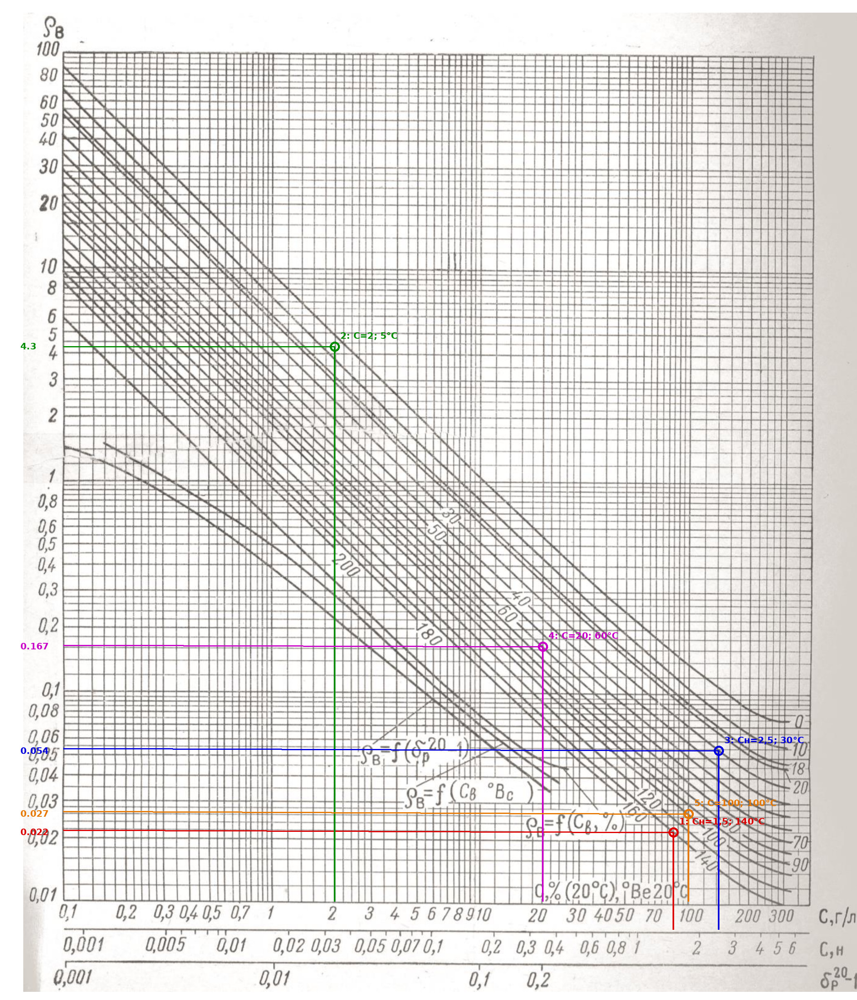
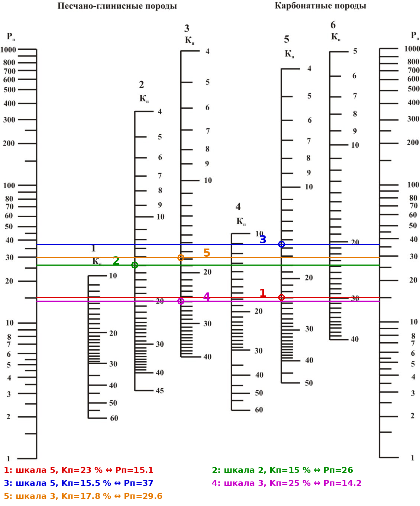
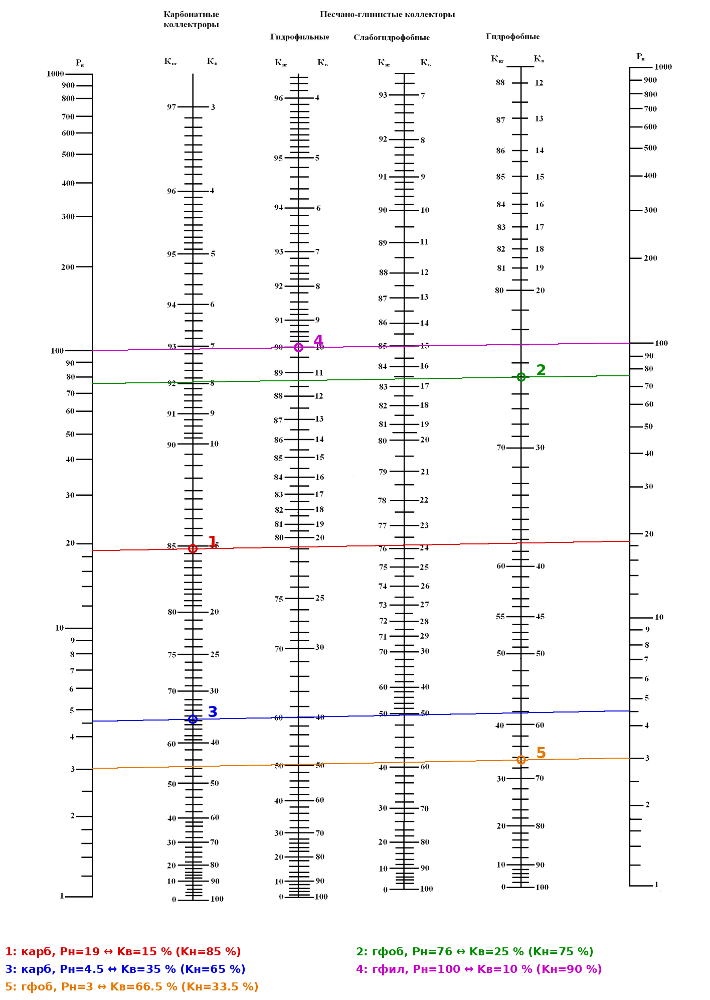

# ДЗ-1, вариант 4 — Kп, Kн, УЭС пород-коллекторов

**Задание** (`ДЗ1-а_задание_вариант4.jpg`): выполнить расчёты по определению Kп и Kн, а также УЭС пород-коллекторов; заполнить таблицу.
**Палетки:** 1-I — ρв растворов NaCl = f(C, t) (= ПАЛ стр. 24, Л03 сл. 6, Лат2007 рис. 1); 9-II — Kп по Pп (= Л03 сл. 9, Лат2007 рис. 4); 6-III — Kв, Kнг по Pн (= Л03 сл. 15, Лат2007 рис. 7а).

## Ответ — заполненная таблица

| № | Порода | Cв | Tпл, °C | Kп, % | Kн, % | ρв, Ом·м | Pп | Pн | ρвп, Ом·м | ρнп, Ом·м |
|---|---|---|---|---|---|---|---|---|---|---|
| 1 | Доломит крупнокристаллический, средней уплотнённости | 1,5 кг-экв/м³ | 140 | 23 | **85** | **0,022** | **15** | **19** | **0,33** | 6,3 |
| 2 | Песчаник слабосцементированный, гидрофобный | 2 кг/м³ | 5 | 15 | 75 | **4,3** | **26** | **76** | **112** | **≈ 8,5·10³** |
| 3 | Доломит крупнокристаллический, средней уплотнённости | 2,5 кг-экв/м³ | 30 | **15,5** | 65 | **0,054** | **37** | **4,5** | 2 | **9,0** |
| 4 | Песчаник среднесцементированный | 20 кг/м³ | 60 | 25 | 90 | **0,17** | **14** | **100** | **2,4** | **≈ 240** |
| 5 | Песчаник среднесцементированный, гидрофобный | 100 кг/м³ | 100 | **18** | **33** | **0,027** | **30** | **3** | 0,8 | 2,4 |

Жирным — найденные величины. Точность снятия с палеток ≈ ±3–5 % (ρв, Pп, Pн), ±0,5–1 % абс. (Kп, Kв).

## Формулы (Л03 сл. 7, 11; Лат2007 формулы (2), (10))
- ρвп = Pп·ρв — УЭС породы при 100 % водонасыщении (1-й закон Арчи–Дахнова, Pп = aм/Kпᵐ).
- ρнп = Pн·ρвп = Pн·Pп·ρв — УЭС нефтенасыщенной породы (Pн = aн/Kвⁿ).
- Отсюда: Pп = ρвп/ρв; Pн = ρнп/ρвп; Kн = 100 − Kв (%).

## Как пользоваться палетками
- **1-I:** по оси X — концентрация: шкала **C, кг/м³ (г/л)** — верхняя; шкала **Cн, кг-экв/м³** — вторая (для строк 1 и 3 отсчитываем прямо по ней; для NaCl 1 кг-экв/м³ ≈ 58,5 кг/м³, т.е. 1,5 → ≈ 88 кг/м³, 2,5 → ≈ 146 кг/м³). Вверх до кривой пластовой температуры → влево, отсчёт ρв. Кривые подписаны t, °C; подписи разрывают кривые — нужную кривую прослеживать до подписи.
- **9-II:** Kп и Pп — **напротив друг друга по горизонтали**; шкала по типу породы: доломит крупнокристаллический средней уплотнённости → шкала «известняки и доломиты крупнокристаллические, средней уплотнённости»; песчаники — «слабо-» / «среднесцементированные».
- **6-III:** Pн ↔ Kв (Kнг) по горизонтали; доломиты → «карбонатные коллекторы»; гидрофобные песчаники → «гидрофобные».

## Решение по строкам

**1. Доломит, Cн = 1,5 кг-экв/м³, 140 °C, Kп = 23 %, ρнп = 6,3 Ом·м**
1. Палетка 1-I: Cн = 1,5 → кривая 140 °C → **ρв ≈ 0,022 Ом·м**.
2. Номограмма 9-II (доломиты крупнокрист., средн. уплотн.): Kп = 23 % → **Pп ≈ 15**.
3. ρвп = Pп·ρв = 15,1·0,022 = **0,33 Ом·м**.
4. Pн = ρнп/ρвп = 6,3/0,33 = **19**.
5. Номограмма 6-III (карбонатные): Pн = 19 → Kв ≈ 15 % → **Kн = 100 − 15 = 85 %**.

**2. Песчаник слабосцементированный, гидрофобный, C = 2 кг/м³, 5 °C, Kп = 15 %, Kн = 75 %**
1. 1-I: C = 2 → кривые 0 °C (ρ ≈ 4,9) и 10 °C (ρ ≈ 3,75); 5 °C — посередине (в логарифмах) → **ρв ≈ 4,3 Ом·м**.
2. 9-II (слабосцементированные песчаники): Kп = 15 % → **Pп ≈ 26**.
3. ρвп = 26·4,3 = **112 Ом·м**.
4. Kв = 100 − 75 = 25 % → 6-III (гидрофобные) → **Pн ≈ 76**.
5. ρнп = Pн·ρвп = 76·112 ≈ **8,5·10³ Ом·м** (очень пресная вода и низкая температура → огромное сопротивление).

**3. Доломит, Cн = 2,5 кг-экв/м³, 30 °C, Kн = 65 %, ρвп = 2 Ом·м**
1. 1-I: Cн = 2,5 → кривая 30 °C → **ρв ≈ 0,054 Ом·м**.
2. Pп = ρвп/ρв = 2/0,054 = **37**.
3. 9-II (доломиты крупнокрист., средн. уплотн.): Pп = 37 → **Kп ≈ 15,5 %**.
4. Kв = 100 − 65 = 35 % → 6-III (карбонатные) → **Pн ≈ 4,5**.
5. ρнп = 4,5·2 = **9,0 Ом·м**.

**4. Песчаник среднесцементированный, C = 20 кг/м³, 60 °C, Kп = 25 %, Kн = 90 %**
1. 1-I: C = 20 → кривая 60 °C → **ρв ≈ 0,17 Ом·м** (0,167).
2. 9-II (среднесцементированные песчаники): Kп = 25 % → **Pп ≈ 14**.
3. ρвп = 14,2·0,167 = **2,4 Ом·м**.
4. Kв = 10 % → 6-III. Смачиваемость в задании не указана → принят **гидрофильный** (обычный случай) → **Pн ≈ 100** (совпадает с Арчи при n = 2: 1/0,1² = 100).
5. ρнп = 100·2,37 ≈ **240 Ом·м**.
   *(Если преподаватель считает его гидрофобным — по той же шкале, что в строках 2 и 5, Pн при Kв = 10 % > 1000, т.е. ρнп > 2,4·10³; слабогидрофобный — Pн ≈ 300, ρнп ≈ 700 Ом·м.)*

**5. Песчаник среднесцементированный, гидрофобный, C = 100 кг/м³, 100 °C, ρвп = 0,8, ρнп = 2,4 Ом·м**
1. 1-I: C = 100 → кривая 100 °C → **ρв ≈ 0,027 Ом·м**.
2. Pп = 0,8/0,027 = **30** → 9-II (среднесцементированные) → **Kп ≈ 18 %**.
3. Pн = ρнп/ρвп = 2,4/0,8 = **3**.
4. 6-III (гидрофобные): Pн = 3 → Kв ≈ 67 % → **Kн ≈ 33 %** (по фото оригинала до 68/32 — в пределах точности).

## Построения
- Палетка ρв (пять точек): 
- Номограмма Pп ↔ Kп: 
- Номограмма Pн ↔ Kв (на этой перерисовке правая шкала Pн чуть выше левой, поэтому линии слегка наклонные — это горизонтали оригинала): 

## Проверка
Все значения сняты пиксельной калибровкой сканов и **независимо перепроверены 4 параллельными проверками**: ρв по скану и по фото палетки; Pп и Pн по перерисовке и по фото; логика, выбор шкал и арифметика.
- **ρв:** расхождение между проверками ≤ 4 %. Контроль по примерам Латышовой (Cн = 0,4, 18 °C → 0,3; 0,46 при 20 °C → 0,27 при 50 °C) — сходится. Формула Арпса (из общих знаний) даёт тот же порядок: 0,024 / 4,4 / 0,052 / 0,17 / 0,029.
- **Pп, Pн:** расхождение ≤ 2 %.
- **Правдоподобие** (Л03 сл. 12):
  - гидрофобные: n = lg Pн / lg(1/Kв) ≈ 2,7–3,1 — в пределах 2,5–5;
  - гидрофильный: n = 2;
  - карбонатная шкала номограммы степенному закону с одним n не подчиняется — брать только с номограммы.
